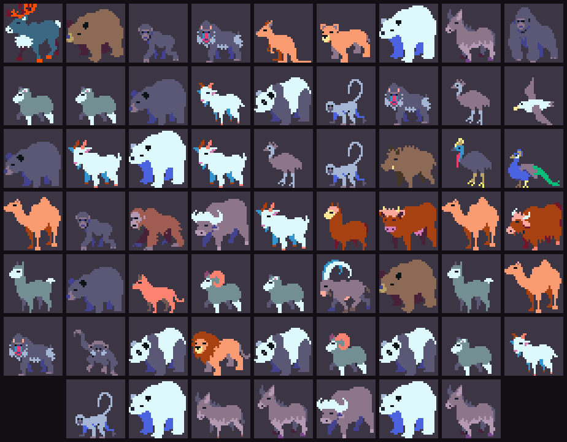
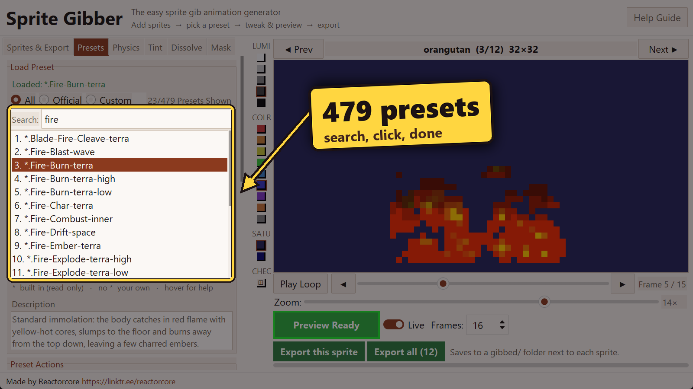

# Sprite Gibber

**Turn any pixel art sprite into a death / destruction animation in a couple of clicks.**

### Get the program here
https://reactorcore.itch.io/sprite-gibber



Sprite Gibber takes your sprite PNGs and blows them apart into tumbling, spinning, gravity-driven chunks, with fire, ice, blood, acid, gold, glitch, nuclear and many more effects. You get ready-to-use **frame PNGs**, a **spritesheet** and an **animated GIF** for each sprite. No animation skills needed, no tedious frame-by-frame drawing. Its fully standalone, fast, batch-capable, unlimited and hella powerful!

Made for indie devs, game jammers and pixel artists who need lots of good-looking death/break/destroy animations without hand-animating every enemy, crate and prop.

You can give the animations to practically anything; be it characters, ghosts, bullets, objects, fireballs, projectiles, grenades, vases, boxes, skeletons, fruits, bread or meatloaves. And the best part its all very easy and fast.

## Features

- **479 presets in 61 effect types**: fire, cryo, electric, plasma, water, acid, blood, meat, bone, rot, stone, gold, crystal, rust, goo, sand, smoke, ash, glitch, matrix, holy, arcane, shadow, nuclear, antimatter and more. Each comes in variations: falling to the ground, floating underwater, crushed inward, drifting in zero gravity, blasted sideways, or bursting from within.
- **Live animated preview** that updates as you change anything.
- **Search and filter** the preset library; click a preset to apply it.
- **Batch export**: tune the look on one sprite, then export your whole sprite list at once.
- **Full control when you want it**: chunk count, blast modes, gravity direction and modes, drag, spin, bounce, wound tint, pixel dissolve, shape masks.
- **Save your own presets**, and a randomizer for discovering new looks.



## How to use

1. Get the Windows build from [itch.io](https://reactorcore.itch.io/sprite-gibber), unzip it anywhere you can write files (e.g. Documents), and run **`SpriteGibber.exe`**. Windows, no install needed.
2. On **Sprites & Export**, click **Add files…** or **Add folder…** and pick your sprites (transparent PNG pixel art; about 32×32 works best).
3. Pick a preset on the **Presets** tab and watch the preview.
4. Click **Export this sprite** or **Export all**. Your files appear in a `gibbed/` folder next to your sprites.

The download includes an `example_sprites/` folder with 35 animal sprites to try presets on (free to use, no attribution needed).

The full guide is in **[guide.md](guide.md)**, also opened by the **Help Guide** button in the app.

## Running from source

For developers with Python 3.10 or newer (developed on 3.13):

```
pip install -r requirements.txt
python main.py
```

There is also a headless batch mode (`main_cli.py`, configured in `params.py`); see [docs/cli-usage.md](docs/cli-usage.md).

## License

The source code is released under the **MIT License**; see [LICENSE](LICENSE).

The ready-to-run Windows build is sold on itch.io: https://reactorcore.itch.io/sprite-gibber. Buying it is the easiest way to use Sprite Gibber and supports further development.

The animations you export are yours to use however you like, including in commercial games. No credit is required (but it's appreciated).

## Contact

reactorcoregames@gmail.com

---

Check out everything else I do: ✨🚀

https://linktr.ee/reactorcore

https://reactorcore.itch.io/

-Reactorcore

---

My other links:

- Home/Links: https://linktr.ee/reactorcore
- Releases: https://reactorcore.itch.io
- Blog: https://www.patreon.com/ReactorcoreGames
- Discord: https://discord.gg/UdRavGhj47
- Catalog: https://reactorcoregames.github.io/
